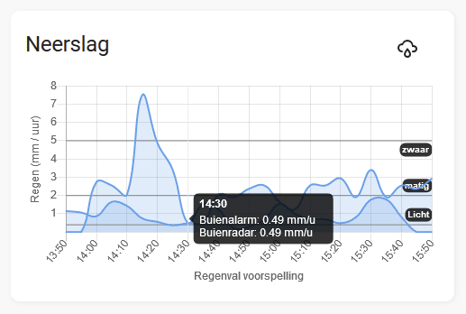

# Neerslag Card

Display rain forecast using BuienAlarm and/or BuienRadar data in Home Assistant.

## Preview


## Installation
Install via HACS:
1. Add `https://github.com/fwelvering/home-assistant-neerslag-card` as a custom repository.
2. Install the card.
3. Add the card to your dashboard.

## Configuration
### Basic Usage
```yaml
type: custom:neerslag-card
entity: sensor.neerslag_buienradar_regen_data
title: Neerslag Voorspelling
```

### Advanced Options
- `title`: (String) The title of the card.
- `autozoom`: (Boolean) If set to `true`, the Y-axis will automatically scale to 0.5mm for better visibility of light rain.
- `entities`: (List) Use this instead of `entity` to display multiple sensors on the same graph.

#### Example: Multiple Entities & Autozoom
```yaml
type: custom:neerslag-card
entities:
  - sensor.neerslag_buienradar_regen_data
  - sensor.neerslag_buienalarm_regen_data
title: BuienRadar vs BuienAlarm
autozoom: true
```

## Technical Improvements (Recent)
- **Lit-native Rendering**: Removed flickering by using `chart.update()` instead of full DOM rebuilds.
- **Data Caching**: Added state-tracking to prevent expensive chart updates when sensor data hasn't changed.
- **Dynamic Parsing**: The card now automatically detects if data comes from BuienRadar or BuienAlarm based on the data structure, not the entity name.
- **Modernized Codebase**: Improved memory usage with static translations and optimized Lit properties.
